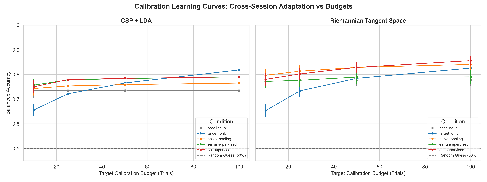
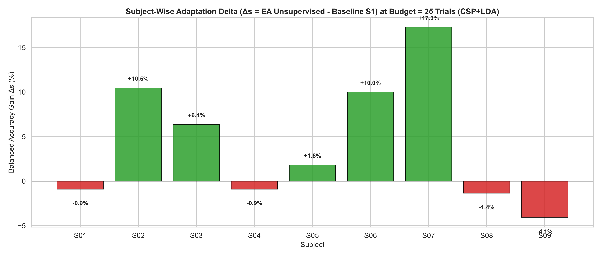

# Calibration-Efficient Cross-Session EEG Adaptation in Motor-Imagery BCI

[](https://www.python.org/downloads/)
[](https://opensource.org/licenses/MIT)
[](https://github.com/psf/black)

A rigorous, leak-free benchmarking framework investigating **Euclidean Alignment (EA)** and **Riemannian geometry** for cross-session transfer learning in Motor-Imagery Brain–Computer Interfaces (MI-BCI). Evaluated on **BCI Competition IV Dataset 2a** across all 9 subjects.

---

## 🔬 Overview & Key Findings

A primary obstacle preventing the practical adoption of MI-BCIs is **cross-session non-stationarity**: models trained on one day degrade substantially when evaluated on subsequent days due to electrode re-positioning, impedance shifts, and user physiological variation.

This repository implements a **strictly inductive, leak-free evaluation protocol**:
* Target-session reference covariance ($\bar{R}_{\text{target}}$) is fitted **strictly on the $K$ calibration trials** ($K \in \{10, 25, 50, 100\}$).
* A fixed, stratified **44-trial test set** per subject is strictly held out and transformed inductively.
* Compares 5 experimental conditions across **CSP + LDA** and **Riemannian Tangent Space** decoders over 5 randomized seeds.

### Key Results
1. **Dramatic Gains on High-Drift Subjects:** On subjects with severe inter-session shift (e.g., Subject 07, 02, 06), Euclidean Alignment boosts decoding accuracy by up to **$+17.3\%$ in unsupervised mode** (zero target labels) and **$+21.8\%$ in supervised mode**.
2. **Calibration Efficiency at Low Budgets:** With just **10 calibration trials** (~2 minutes), training a model from scratch (**Target-Only**) fails with an unusable **$65.6\%$** balanced accuracy. Transferring an existing session via Euclidean Alignment achieves **$75.7\% - 78.0\%$** ($+10.4\%$ advantage).
3. **Riemannian Manifold Superiority:** Riemannian Tangent Space classification consistently outperforms CSP+LDA across all calibration budgets, achieving **$85.6\% \pm 13.0\%$** cohort accuracy at full budget.
4. **The Over-Alignment Diagnostic:** For subjects whose sessions were already stable (e.g., Subject 01 and 08 with $>95\%$ baseline accuracy), aligning with very small calibration budgets introduces minor finite-sample covariance noise ($-0.9\%$ to $-1.4\%$), highlighting the need for threshold-based selective alignment.

---

## 📊 Visualizations

### Calibration Efficiency Learning Curves


### Per-Subject Alignment Gain / Loss Breakdown


---

## 📁 Repository Structure

```
├── configs/
│   └── splits/                # Frozen stratified 44-trial test splits per subject (.npz)
├── results/
│   ├── figures/               # Calibration curves and delta bar charts (.png)
│   ├── tables/                # Full trial logs, summary tables, and cohort statistics (.csv)
│   └── all_9_subjects_results.pdf
├── scripts/
│   ├── run_full_benchmark.py  # Full 9-subject benchmark across budgets [10, 25, 50, 100]
│   ├── run_pilot_subject1.py  # Fast pilot experiment on Subject 1
│   └── generate_pdf_table.py  # Formatted publication-ready PDF table generator
├── src/
│   ├── alignment.py           # Euclidean Alignment (EA) & regularized reference whitening
│   ├── data.py                # MNE raw loading, Butterworth bandpass (8-30 Hz), epoching
│   ├── evaluation.py          # Inductive evaluation pipeline & nested budget sampler
│   └── models.py              # CSP+LDA and Riemannian Tangent Space pipelines
├── tests/
│   ├── test_alignment.py      # Mathematical verification of EA invariants
│   └── test_data_loader.py    # Data shape and label integrity unit tests
├── requirements.txt           # Python dependencies
└── README.md
```

---

## 🚀 Getting Started

### 1. Installation

Clone the repository and install required packages:

```bash
git clone https://github.com/Tanmay4440/-Cross-Session-EEG-Adaptation.git
cd -Cross-Session-EEG-Adaptation
pip install -r requirements.txt
```

### 2. Dataset Setup

The benchmark uses the official **BCI Competition IV Dataset 2a** (9 subjects, 22 EEG channels, 250 Hz, 2 sessions: `T` and `E`).

Download the dataset files from the [Graz University BCI Competition IV archive](http://www.bbci.de/competition/iv/) and place them in the following directory layout:

```
official data/
├── BCICIV_2a_gdf/
│   ├── A01T.gdf ... A09T.gdf   (Session 1: Training runs)
│   └── A01E.gdf ... A09E.gdf   (Session 2: Evaluation runs)
└── true_labels/
    ├── A01T.mat ... A09T.mat
    └── A01E.mat ... A09E.mat   (Evaluation true labels)
```

*(Note: `official data/` is ignored by Git to adhere to repository size limits).*

### 3. Run Verification Tests

Run the test suite to verify signal preprocessing and Euclidean Alignment invariants:

```bash
pytest
```

### 4. Running Benchmarks

Run a single-subject pilot:
```bash
python scripts/run_pilot_subject1.py
```

Run the full cohort benchmark across all 9 subjects:
```bash
python scripts/run_full_benchmark.py
```

---

## 📑 Methodology Summary

* **Bandpass Filter:** 4th-order zero-phase Butterworth filter ($8.0 - 30.0\text{ Hz}$).
* **Epoch Window:** $[1.0\text{s}, 4.0\text{s}]$ post-cue ($750\text{ samples}$ at $250\text{ Hz}$).
* **Channel Count:** Exactly 22 EEG channels (auxiliary EOG channels discarded).
* **Reference Covariance Estimation:**
  $$\bar{R} = \frac{1}{N} \sum_{i=1}^N X_i X_i^T, \quad \bar{R}_{\text{reg}} = \bar{R} + \epsilon \frac{\text{Tr}(\bar{R})}{C} I$$
* **Whitening Transform:**
  $$\tilde{X}_i = \bar{R}_{\text{reg}}^{-1/2} X_i$$

---

## 📜 License

This project is licensed under the MIT License - see the LICENSE file for details.
